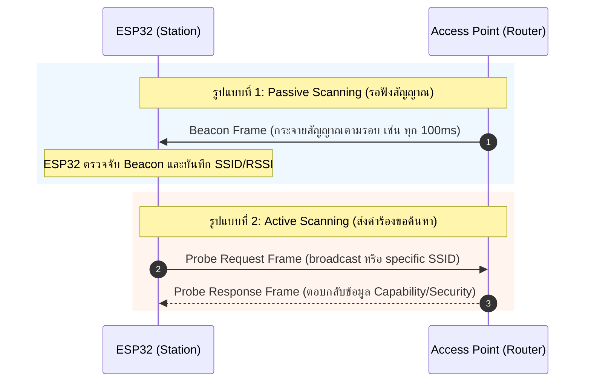

# เฟสย่อยที่ 1: Scan Phase (การสแกนหาเครือข่าย Wi-Fi)

ในการเชื่อมต่อ Wi-Fi ของ ESP32 ขั้นตอนแรกสุดหลังจากเริ่มต้น Wi-Fi Driver คือ **Scan Phase** ซึ่งเป็นกระบวนการค้นหา Access Point (AP) ในบริเวณใกล้เคียงเพื่อตรวจสอบว่า AP ที่ระบุไว้ใน Configuration (SSID และ BSSID) มีอยู่จริง ทำงานอยู่ใน Channel ใด และมีระดับความแรงสัญญาณ (RSSI) เท่าใด

---

## 1. กลไกการสแกนสัญญาณ (Scanning Mechanisms)

กระบวนการสแกนสัญญาณตามมาตรฐาน IEEE 802.11 แบ่งออกเป็น 2 รูปแบบหลักดังรูป



1. **Passive Scanning (การสแกนแบบตั้งรับ)**: ESP32 จะคอยรับฟังแพ็กเกจ **Beacon Frame** ที่ AP ส่งกระจายออกมาตามรอบเวลา (ปกติประมาณ 100ms) ในแต่ละ Channel การสแกนแบบนี้ช่วยประหยัดพลังงานแต่ใช้เวลานานกว่า
2. **Active Scanning (การสแกนแบบรุก - เป็น Default ของ ESP32)**: ESP32 จะส่ง **Probe Request Frame** ออกไปในทุกช่องสัญญาณ (Channel 1-13) แล้วรอรับ **Probe Response Frame** จาก AP เพื่อให้ทราบข้อมูลของเครือข่ายอย่างรวดเร็ว

---

## 2. ลำดับขั้นตอนและ Event ภายใน ESP32 Driver

* **s1.1**: เมื่อแอปพลิเคชันเรียกใช้คำสั่ง `esp_wifi_connect()` หรือ `WiFi.begin(ssid, password)` Wi-Fi Driver จะเริ่มเข้าสู่ State สแกนหา Access Point ตาม SSID ที่กำหนดไว้ใน Configuration
* **s1.2**: หากทำการสแกนครบทุก Channel แล้ว **สแกนไม่พบ Access Point** (เช่น AP ปิดอยู่, อยู่ไกลเกินไป, หรือพิมพ์ SSID ผิด)
  * ไดรเวอร์จะปล่อย Event ชื่อ `WIFI_EVENT_STA_DISCONNECTED`
  * Wi-Fi driver จะส่ง result code / Disconnect Reason ออกมาเป็น:
    - **`WIFI_REASON_NO_AP_FOUND`** (0x201 / Value 201)

---

## 3. ตัวอย่างการใช้คำสั่งสแกนในทางปฏิบัติ (Code Examples)

### ตัวอย่าง: ESP-IDF Scan API (C Language)
```c
wifi_scan_config_t scan_config = {
    .ssid = (uint8_t *)"MyHomeWiFi", // สแกนหา SSID ที่ระบุ
    .bssid = NULL,
    .channel = 0,                    // 0 = สแกนทุก Channel (1-13)
    .show_hidden = true              // รวม Hidden SSID ด้วย
};
// สั่งสแกนหา AP
ESP_ERROR_CHECK(esp_wifi_scan_start(&scan_config, true));
```

### ตัวอย่าง: Arduino ESP32 Scan API (C++)
```cpp
#include <WiFi.h>

void setup() {
  Serial.begin(115200);
  WiFi.mode(WIFI_STA);
  WiFi.disconnect();
  
  int n = WiFi.scanNetworks(); // ทำการ Active Scan
  Serial.printf("พบเครือข่ายทั้งหมด %d เครือข่าย\n", n);
  for (int i = 0; i < n; ++i) {
    Serial.printf("%d: %s (%d dBm)\n", i + 1, WiFi.SSID(i).c_str(), WiFi.RSSI(i));
  }
}
```

---

## 4. สาเหตุปัญหาในเฟส Scan และแนวทางแก้ไข (Troubleshooting)

| ปัญหาที่พบ | สาเหตุที่เป็นไปได้ | แนวทางแก้ไข |
| :--- | :--- | :--- |
| `WIFI_REASON_NO_AP_FOUND` | สะกด SSID ไม่ถูกต้อง (ตัวพิมพ์เล็ก/ใหญ่มีผล) | ตรวจสอบตัวอักษรและช่องว่างใน SSID ให้ตรงเป๊ะ |
| สแกนไม่เจอสัญญาณ | AP ตั้งค่าความถี่เป็น 5GHz | ESP32 (ส่วนใหญ่เช่น WROOM-32) รองรับเฉพาะ **2.4GHz** เท่านั้น |
| สแกนไม่เจอ AP ซ่อนอยู่ | AP เป็นแบบ Hidden SSID | ตั้งค่า `scan_method = WIFI_ALL_CHANNEL_SCAN` และเปิด flag `show_hidden` |
| สัญญาณขาดหายเป็นระยะ | AP อยู่ใน Channel ที่มีสัญญาณรบกวนสูง | เปลี่ยน Channel ของ AP หรือเพิ่มสายอากาศภายนอก |

---

## 5. คำถามทบทวนความเข้าใจ (Checkpoints)

1. การสแกนแบบ **Active Scanning** กับ **Passive Scanning** ต่างกันอย่างไรในแง่ของปริมาณ Traffic บนอากาศและเวลาที่ใช้?

- **Active Scanning**: อุปกรณ์จะส่ง **Probe Request** ออกไปเองในแต่ละ Channel เพื่อถาม AP ที่อยู่บริเวณนั้นว่า "มีใครอยู่บ้าง" แล้วรอรับ **Probe Response** กลับมา วิธีนี้ทำให้เกิด Traffic เพิ่มขึ้นบนอากาศ (ทั้ง Probe Request และ Probe Response) แต่ใช้**เวลาน้อยกว่า** เพราะไม่ต้องรอ Beacon Frame ตามรอบเวลาปกติของ AP จึงเป็นวิธีที่นิยมใช้ในอุปกรณ์ทั่วไปเพื่อสแกนหาเครือข่ายได้รวดเร็ว
- **Passive Scanning**: อุปกรณ์จะไม่ส่งอะไรออกไปเลย เพียงแค่ "ฟัง" (Listen) **Beacon Frame** ที่ AP แต่ละตัวส่งออกมาเป็นระยะๆ ตามรอบเวลาที่กำหนด (Beacon Interval) วิธีนี้ทำให้เกิด Traffic บนอากาศ**น้อยกว่า**มาก (ไม่มีการส่ง Probe Request เพิ่ม) แต่ใช้**เวลานานกว่า** เพราะต้องรอจนกว่าจะถึงรอบที่ AP ส่ง Beacon ออกมาในแต่ละ Channel ที่สแกน จึงเหมาะกับกรณีที่ต้องการความเงียบ (Stealth) มากกว่าความเร็ว

2. หาก ESP32 รองรับเฉพาะความถี่ 2.4GHz แต่เราพยายามเชื่อมต่อกับ Router 5GHz จะเกิด Event ใด และได้ Reason Code อะไร?

ในกรณีนี้ ESP32 จะ**ไม่สามารถค้นหาหรือมองเห็น SSID ของ Router 5GHz ได้เลย** ตั้งแต่ขั้นตอน Scanning เนื่องจากฮาร์ดแวร์ของ ESP32 ไม่มี Radio ที่รองรับย่านความถี่ 5GHz จึงไม่สามารถรับสัญญาณ Beacon หรือส่ง Probe Request ไปยัง Channel ในย่านนั้นได้ตั้งแต่ต้น

ผลลัพธ์คือเมื่อเรียก `esp_wifi_connect()` ระบบจะไม่สามารถหา AP ที่ตรงกับ SSID ที่ระบุไว้เจอ (เพราะไม่เคยสแกนเจอ) จึงเกิด Event `WIFI_EVENT_STA_DISCONNECTED` ทันทีโดยไม่ผ่านขั้นตอน Auth/Assoc เลย พร้อม Reason Code ที่มักพบคือ **`WIFI_REASON_NO_AP_FOUND` (Reason Code = 201)** ซึ่งบ่งชี้ว่าไม่พบ Access Point ที่มี SSID ตรงกันในผลการสแกน ไม่ใช่ Reason Code ที่เกี่ยวข้องกับ Authentication หรือ Handshake ที่ผิดพลาดแต่อย่างใด