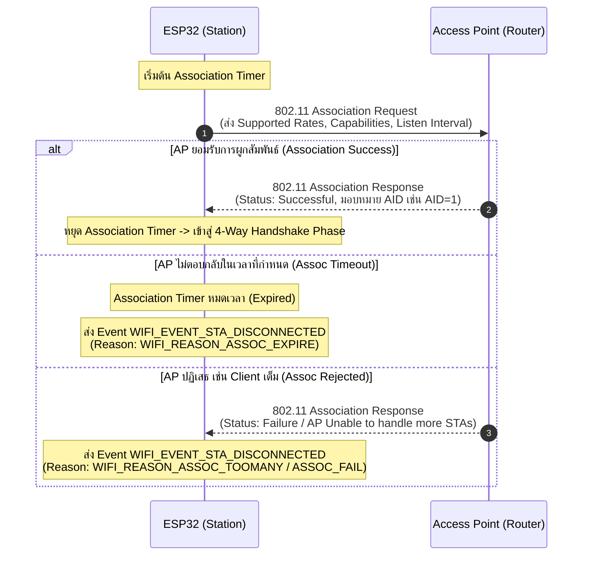

# เฟสย่อยที่ 3: Association Phase (การผูกสัมพันธ์และการตกลงคุณสมบัติ)

เมื่อ ESP32 ผ่านขั้นตอน Authentication ในระดับ Link Layer เรียบร้อยแล้ว จะเข้าสู่ **Association Phase** ซึ่งเป็นกระบวนการที่ ESP32 ส่งคำร้องขอจดทะเบียนผูกสัมพันธ์กับ Access Point (AP) เพื่อตกลงคุณสมบัติและพารามิเตอร์ของเครือข่าย เช่น อัตราการรับส่งข้อมูลที่รองรับ (Supported Data Rates), ประเภทการเข้ารหัส, และรับหมายเลขประจำตัว **Association ID (AID)** จาก AP

---

## 1. ลำดับการแลกเปลี่ยนแพ็กเกจ Association (Sequence Diagram)

---

## 2. รายละเอียดขั้นตอนทางเทคนิค (Step Breakdown)

* **s3.1**: ในขั้นนี้ ESP32 จะเริ่มต้นส่งแพ็กเกจ **Association Request** ไปยัง AP พร้อมเปิดใช้งาน **Association Timer** เพื่อรอคอยคำตอบรับ
* **s3.2 (กรณีหมดเวลา)**: หากเลยกำหนดเวลาของ Association Timer แล้ว แต่ยังไม่ได้รับการตอบกลับจาก AP:
  * ไดรเวอร์จะปล่อย Event ชื่อ **`WIFI_EVENT_STA_DISCONNECTED`**
  * ไดรเวอร์จะแจ้ง Result Code ออกมาเป็น: **`WIFI_REASON_ASSOC_EXPIRE`** (Value 4)
* **s3.3 (กรณีสำเร็จ)**: หากได้รับแพ็กเกจ **Association Response** ที่ระบุสถานะสำเร็จจาก AP:
  * **Association Timer จะหยุดทำงาน**
  * ESP32 จะได้รับ **Association ID (AID)** จาก AP และเตรียมพร้อมเข้าสู่กระบวนการสร้าง Encryption Keys ในเฟสถัดไป
* **s3.4 (กรณีถูกปฏิเสธ)**: หาก AP ตอบปฏิเสธแพ็กเกจ Association Response (เช่น AP มีจำนวน Client เชื่อมต่อเต็มขีดจำกัดแล้ว หรือไม่รองรับ Rate ที่ ESP32 ร้องขอ):
  * ไดรเวอร์จะปล่อย Event ชื่อ **`WIFI_EVENT_STA_DISCONNECTED`**
  * ไดรเวอร์จะแจ้ง Result Code ออกมาเป็น: **`WIFI_REASON_ASSOC_FAIL`** (Value 3) หรือ **`WIFI_REASON_ASSOC_TOOMANY`** (Value 17)

---

## 3. ตารางสรุป Result Code ใน Association Phase

| Reason Code Constant | รหัสตัวเลข | สื่อความหมายถึง | สาเหตุที่อาจเกิดขึ้นในทางปฏิบัติ |
| :--- | :--- | :--- | :--- |
| `WIFI_REASON_ASSOC_FAIL` | 3 | AP ปฏิเสธการผูกสัมพันธ์ | คุณสมบัติเครือข่ายไม่ตรงกัน (Capability Mismatch) |
| `WIFI_REASON_ASSOC_EXPIRE` | 4 | หมดเวลาการรอคำตอบ Association | สัญญาณรบกวนสูง แพ็กเกจตกหล่น |
| `WIFI_REASON_ASSOC_TOOMANY` | 17 | AP ไม่สามารถรับ Client เพิ่มได้อีก | อุปกรณ์ที่ต่อ Router เต็มจำนวนที่กำหนดไว้ (Max STA Exceeded) |

---

## 4. คำถามทบทวนความเข้าใจ (Checkpoints)

1. **Association ID (AID)** คืออะไร และมีประโยชน์อย่างไรต่อ Access Point ในการจัดการอุปกรณ์ไร้สาย?

**Association ID (AID)** คือหมายเลขประจำตัวแบบไม่ซ้ำกัน (มีค่าตั้งแต่ 1-2007) ที่ AP กำหนดให้กับ Client แต่ละเครื่องในขั้นตอน **Association Phase** เมื่อ Client เชื่อมต่อสำเร็จ โดย AP จะส่งค่านี้กลับมาพร้อมกับ Association Response Frame

ประโยชน์ของ AID ต่อ AP มีดังนี้:
- **ระบุตัวตนอุปกรณ์ภายในเครือข่าย**: AP ใช้ AID เพื่อแยกแยะและติดตามอุปกรณ์แต่ละเครื่องที่เชื่อมต่ออยู่ในขณะนั้น แทนการอ้างอิงด้วย MAC Address เพียงอย่างเดียวในบางกลไกภายใน
- **จัดการ Power Save Mode**: AP ใช้ AID ในการ map กับ **TIM (Traffic Indication Map)** ที่แนบมากับ Beacon Frame เพื่อบอกอุปกรณ์ที่อยู่ในโหมดประหยัดพลังงาน (Sleep) ว่ามีข้อมูลค้างอยู่ที่ AP รอส่งให้หรือไม่ โดยแต่ละ Bit ใน TIM จะสอดคล้องกับ AID ของแต่ละเครื่อง
- **จัดการ Buffer และ Queue**: AP ใช้ AID เพื่อจัดสรร Buffer สำหรับเก็บข้อมูลที่จะส่งให้ Client แต่ละเครื่อง โดยเฉพาะเมื่อ Client อยู่ในสถานะ Sleep
- **จำกัดจำนวนอุปกรณ์ที่เชื่อมต่อ**: เนื่องจาก AID มีช่วงค่าจำกัด (1-2007) จึงเป็นกลไกหนึ่งที่ AP ใช้ควบคุมจำนวนอุปกรณ์สูงสุดที่รองรับได้พร้อมกัน

2. หาก Router รองรับอุปกรณ์ได้สูงสุด 32 เครื่อง และ ESP32 เป็นเครื่องที่ 33 พยายามจะเชื่อมต่อ จะเกิดเหตุการณ์ใดขึ้นใน Association Phase?

ESP32 จะสามารถผ่านขั้นตอน **Authentication (Phase 2)** ได้ตามปกติ เนื่องจากขั้นตอนนี้ยังไม่เกี่ยวข้องกับการจัดสรรทรัพยากรหรือ AID แต่อย่างใด แต่เมื่อเข้าสู่ **Association Phase (Phase 3)** ซึ่ง AP ต้องจัดสรร AID และ Buffer ให้กับอุปกรณ์ใหม่ เนื่องจาก Router มีอุปกรณ์เชื่อมต่ออยู่เต็มจำนวนสูงสุด (32 เครื่อง) อยู่แล้ว AP จะไม่มีทรัพยากรเพียงพอที่จะรองรับอุปกรณ์เครื่องที่ 33 ได้

ผลลัพธ์คือ AP จะปฏิเสธคำขอ Association โดยส่ง **Association Response Frame** กลับมาพร้อม Status Code ที่ระบุว่าปฏิเสธเนื่องจากทรัพยากรไม่เพียงพอ (เช่น Status Code 17 = "Association denied because AP is unable to handle additional associated STAs") ทำให้ ESP32 ไม่ได้รับ AID และไม่สามารถเข้าสู่สถานะ `run` ได้ จากนั้นจะเกิด Event `WIFI_EVENT_STA_DISCONNECTED` ตามมา พร้อม Reason Code ที่มักพบคือ **`WIFI_REASON_AP_TABKICK`** หรือ Reason Code ในกลุ่มที่เกี่ยวข้องกับ Association Failure เนื่องจากทรัพยากรของ AP เต็ม โดยจะไม่มีการเข้าสู่ขั้นตอน 4-Way Handshake เลย เพราะกระบวนการล้มเหลวตั้งแต่ระดับ Association ก่อนที่จะไปถึงขั้นตอนแลกเปลี่ยนกุญแจเข้ารหัส