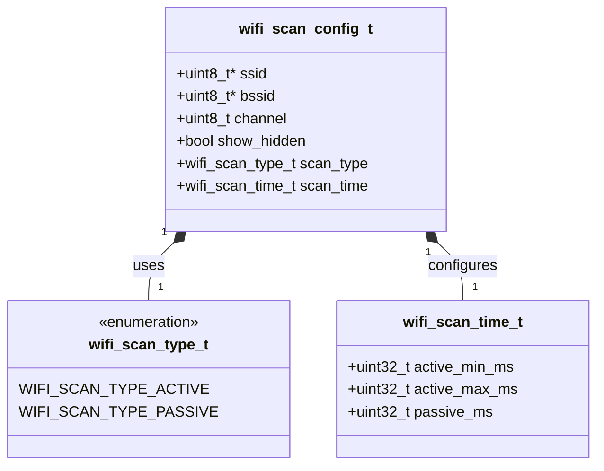
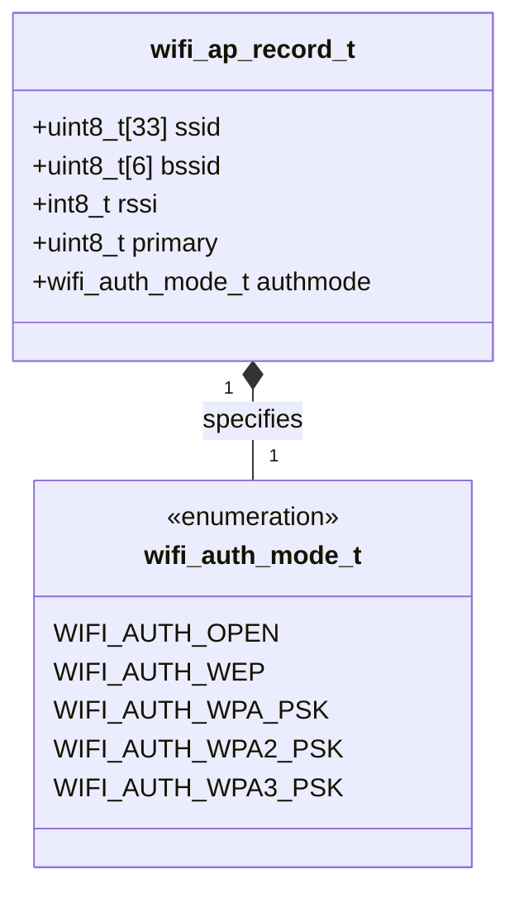

# ใบงานที่ 5.1: การเชื่อมต่อ Wi-Fi และการค้นหาสัญญาณรอบข้าง (Wi-Fi Connection and Scanning)

## 0. กล่าวนำ (Introduction)
ใบงานในสัปดาห์นี้ จะแสดง console log แบบ forensic  โดยละเอียด จะทำให้นักศึกษาเห็นทั้งฟังก์ชันที่เรียกใช้งานและค่าที่ return กลับมา
เพื่อให้เกิดประสบการณ์ในการวิเคราะห์ปัญหาหน้างานจริงในการใช้ Wi-Fi บน ESP32 ที่รันบน framework ESP-IDF ได้

## 1. วัตถุประสงค์ (Objectives)
1. เรียนรู้และเข้าใจกระบวนการทำงานเบื้องต้นของการใช้งาน ESP32 ในโหมด Station (STA Mode) ผ่านเฟรมเวิร์ก ESP-IDF
2. เรียนรู้การตั้งค่าและใช้งาน API สำหรับสแกนสัญญาณ Wi-Fi (Scan Phase) ในรูปแบบต่าง ๆ ผ่าน `esp_wifi.h`
3. สามารถเขียนโปรแกรมค้นหา Access Point (AP) แบบทั่วไป (General Scan), แบบระบุช่องความถี่ (Channel-Specific Scan) และแบบระบุชื่อเครือข่ายเจาะจง (Targeted SSID Scan)
4. อ่านค่าและแสดงผลรายละเอียดของ AP เช่น SSID, MAC Address (BSSID), RSSI, Channel และ Encryption Type ผ่าน Serial Monitor (ESP-IDF Console) ได้อย่างถูกต้อง

---

## 2. อุปกรณ์และซอฟต์แวร์ที่ใช้ในการทดลอง (Equipment & Tools)
1. บอร์ดไมโครคอนโทรลเลอร์ ESP32 (เช่น ESP32 DevKit V1) จำนวน 1 บอร์ด
2. สายเชื่อมต่อ Micro-USB หรือ USB-C (ตามรุ่นของบอร์ด) จำนวน 1 เส้น
3. คอมพิวเตอร์ที่ติดตั้งโปรแกรม IDE เช่น VS Code พร้อมทั้ง ESP-IDF (อาจจะติดตั้งบนเครื่องหรือบน Docker ก็ได้)

---

## 3. ความรู้พื้นฐานที่เกี่ยวข้อง (Theoretical Background - ESP-IDF Framework)

### 3.1 การเริ่มต้น Wi-Fi Stack บน ESP-IDF
ในเฟรมเวิร์ก ESP-IDF การทำงานของ Wi-Fi จำเป็นต้องเริ่มต้นโมดูลพื้นฐานของระบบก่อนตามลำดับ ได้แก่ NVS Flash (สำหรับจัดเก็บ Configuration), Network Interface (esp_netif) และ Event Loop ดังตัวอย่างต่อไปนี้

```c
#include "nvs_flash.h"
#include "esp_netif.h"
#include "esp_event.h"
#include "esp_wifi.h"

void init_wifi_sta(void) {
    // 1. Initialize NVS Flash
    esp_err_t ret = nvs_flash_init();
    if (ret == ESP_ERR_NVS_NO_FREE_PAGES || ret == ESP_ERR_NVS_NEW_VERSION_FOUND) {
        ESP_ERROR_CHECK(nvs_flash_erase());
        ret = nvs_flash_init();
    }
    ESP_ERROR_CHECK(ret);

    // 2. Initialize Network Interface & Event Loop
    ESP_ERROR_CHECK(esp_netif_init());
    ESP_ERROR_CHECK(esp_event_loop_create_default());
    esp_netif_create_default_wifi_sta();

    // 3. Initialize Wi-Fi Driver in Station Mode
    wifi_init_config_t cfg = WIFI_INIT_CONFIG_DEFAULT();
    ESP_ERROR_CHECK(esp_wifi_init(&cfg));
    ESP_ERROR_CHECK(esp_wifi_set_mode(WIFI_MODE_STA));
    ESP_ERROR_CHECK(esp_wifi_start());
}
```

### 3.2 กระบวนการสแกนสัญญาณด้วย `wifi_scan_config_t`
ในมาตรฐาน IEEE 802.11 กระบวนการ **Scan Phase** เป็นขั้นตอนแรกที่ ESP32 จะสำรวจสภาพแวดล้อมทางคลื่นวิทยุ 2.4GHz โดย ESP-IDF มีโครงสร้างข้อมูล `wifi_scan_config_t` สำหรับกำหนดเงื่อนไขในการสแกน

```c
typedef struct {
    uint8_t *ssid;               // Target SSID (NULL = scan all SSIDs)
    uint8_t *bssid;              // Target MAC address (NULL = scan all BSSIDs)
    uint8_t channel;             // Target channel (0 = scan all channels 1-13)
    bool show_hidden;            // true = include hidden SSIDs in scan result
    wifi_scan_type_t scan_type;  // WIFI_SCAN_TYPE_ACTIVE or WIFI_SCAN_TYPE_PASSIVE
    wifi_scan_time_t scan_time;  // Scan duration per channel
} wifi_scan_config_t;
```

#### แผนผังโครงสร้างข้อมูล (Class Diagram of `wifi_scan_config_t`)



**คำสั่งสั่งสแกน**  `esp_wifi_scan_start(&scan_config, true)` โดยหากใส่พารามิเตอร์ตัวหลังเป็น `true` จะเป็นการสแกนแบบ Synchronous (รอจนกว่าการสแกนจะเสร็จสมบูรณ์)

### 3.3 การดึงรายละเอียดของ Access Point (`wifi_ap_record_t`)
เมื่อสแกนเสร็จสิ้น สามารถอ่านจำนวน AP ที่พบด้วย `esp_wifi_scan_get_ap_num()` และอ่านรายละเอียดโครงสร้าง `wifi_ap_record_t` ด้วย `esp_wifi_scan_get_ap_records()` ซึ่งประกอบด้วยสมาชิกสำคัญ ดังต่อไปนี้

#### แผนผังโครงสร้างข้อมูล (Class Diagram of `wifi_ap_record_t`)



| ตัวแปรสมาชิก | รายละเอียด                 | ข้อมูล                          |
| ------------ | -------------------------- | ------------------------------- |
| `ssid`       | ชื่อเครือข่าย Wi-Fi        | (อาร์เรย์ uint8_t ขนาด 33 ไบต์) |
| `bssid`      | หมายเลข MAC Address ของ AP | (อาร์เรย์ uint8_t ขนาด 6 ไบต์)  |
| `rssi`       | ความแรงของสัญญาณวิทยุ      | (หน่วย dBm)                     |
| `primary`    | ช่องความถี่วิทยุหลัก       | (Channel 1-13)                  |
| `authmode`   | ประเภทการเข้ารหัสความปลอดภัย | (`wifi_auth_mode_t` เช่น `WIFI_AUTH_OPEN`, `WIFI_AUTH_WPA2_PSK`, `WIFI_AUTH_WPA3_PSK`)|

---

## 4. ขั้นตอนและโปรแกรมทดสอบการทดลอง (Experimental Procedures)

ในใบงานนี้ โปรแกรมจะทำการสแกนค้นหาสัญญาณ Wi-Fi ใน 4 กรณีหลักแบบ Forensic Logging และจะ**หยุดการทำงานในเฟสที่ 1 (Scan Phase)** เท่านั้น โดยแสดงผลสรุปผ่าน ESP-IDF Serial Console

### 5.1.1 การสแกนหา AP ทั่วไป (General AP Scan)
เป็นการสแกนครอบคลุมทุกช่องความถี่ (Channel 1-13) และทุก SSID (`.ssid = NULL`, `.channel = 0`) เพื่อสำรวจเครือข่าย Wi-Fi ทั้งหมดที่อยู่บริเวณรอบข้าง

### 5.1.2 การสแกนหา AP โดยกำหนดช่วงความถี่ (Channel-Specific Scan)
เป็นการระบุช่องความถี่เจาะจง (เช่น `.channel = 1`) เพื่อลดเวลาที่ใช้ในการสแกน เหมาะสำหรับกรณีที่ทราบล่วงหน้าว่า AP เป้าหมายทำงานอยู่ใน Channel ใด

### 5.1.3 การสแกนหา AP โดยกำหนดชื่อที่เจาะจงกรณีมีอยู่จริง (Targeted SSID Scan - Existing)
เป็นการระบุชื่อ SSID ที่ต้องการสแกนโดยเฉพาะ (`.ssid = (uint8_t *)"Target_SSID"`) นำชื่อ SSID ที่พบจากการสแกนทั่วไปในข้อ 5.1.1 มาทดสอบสแกนแบบเจาะจง

### 5.1.4 การสแกนหา AP โดยกำหนดชื่อที่เจาะจงกรณีไม่มีอยู่จริง (Targeted SSID Scan - Non-Existent)
เป็นการระบุชื่อ SSID สมมุติที่ไม่มีอยู่จริง (ในใบงานนี้คือ `"NON_EXISTENT_AP_9999"`) เพื่อสังเกตการตอบสนองและ Error Handling ของระบบ (พบ 0 AP)

---

## 5. ซอร์สโค้ดการทดลอง (Complete ESP-IDF Source Code - `main.c`)

ให้นักศึกษานำซอร์สโค้ด C ต่อไปนี้ไปวางในไฟล์ `main/main.c` ของโปรเจกต์ ESP-IDF ทำการ Build และ Flash ลงบอร์ด ESP32 จากนั้นเปิด ESP-IDF Monitor (Baud Rate `115200`) เพื่อสังเกตผลการทำงาน

```c
#include "esp_event.h"
#include "esp_log.h"
#include "esp_netif.h"
#include "esp_system.h"
#include "esp_timer.h"
#include "esp_wifi.h"
#include "freertos/FreeRTOS.h"
#include "freertos/task.h"
#include "nvs_flash.h"
#include <stdio.h>
#include <string.h>

static const char *TAG = "LAB_WIFI_SCAN";

// Convert wifi_auth_mode_t enum to readable string
static const char *get_auth_mode_name(wifi_auth_mode_t authmode) {
  switch (authmode) {
  case WIFI_AUTH_OPEN:
    return "OPEN (No Password)";
  case WIFI_AUTH_WEP:
    return "WEP";
  case WIFI_AUTH_WPA_PSK:
    return "WPA_PSK";
  case WIFI_AUTH_WPA2_PSK:
    return "WPA2_PSK";
  case WIFI_AUTH_WPA_WPA2_PSK:
    return "WPA_WPA2_PSK";
  case WIFI_AUTH_WPA2_ENTERPRISE:
    return "WPA2_ENTERPRISE";
  case WIFI_AUTH_WPA3_PSK:
    return "WPA3_PSK";
  case WIFI_AUTH_WPA2_WPA3_PSK:
    return "WPA2_WPA3_PSK";
  case WIFI_AUTH_WAPI_PSK:
    return "WAPI_PSK";
  default:
    return "UNKNOWN";
  }
}

// Perform Wi-Fi scan and display detailed AP records
static void perform_wifi_scan(wifi_scan_config_t *scan_config,
                              const char *test_title, char *found_first_ssid,
                              size_t max_ssid_len) {
  ESP_LOGI(
      TAG,
      "------------------------------------------------------------------");
  ESP_LOGI(TAG, ">>> %s", test_title);
  ESP_LOGI(
      TAG,
      "------------------------------------------------------------------");

  ESP_LOGI(TAG,
           "[FORENSIC]: Call esp_wifi_scan_start(scan_config, block=true)");
  int64_t start_time = esp_timer_get_time();
  esp_err_t err = esp_wifi_scan_start(scan_config, true);
  int64_t duration_ms = (esp_timer_get_time() - start_time) / 1000;
  ESP_LOGI(TAG,
           "[FORENSIC]: esp_wifi_scan_start() returned %s (0x%x) [Duration: "
           "%lld ms]",
           esp_err_to_name(err), err, duration_ms);

  if (err != ESP_OK) {
    ESP_LOGE(TAG, "[STATUS]: Scan failed (Error: %s / Code: 0x%x)",
             esp_err_to_name(err), err);
    return;
  }

  uint16_t ap_count = 0;
  ESP_LOGI(TAG, "[FORENSIC]: Call esp_wifi_scan_get_ap_num(&ap_count)");
  esp_err_t err_ap_num = esp_wifi_scan_get_ap_num(&ap_count);
  ESP_LOGI(
      TAG,
      "[FORENSIC]: esp_wifi_scan_get_ap_num() returned %s (0x%x), ap_count=%u",
      esp_err_to_name(err_ap_num), err_ap_num, ap_count);

  ESP_LOGI(TAG, "[STATUS]: Scan SUCCESS");
  ESP_LOGI(TAG, "[AP COUNT]: %u network(s) found", ap_count);

  if (ap_count == 0) {
    ESP_LOGW(TAG, "[NOTE]: No Access Point found matching the criteria.");
  } else {
    wifi_ap_record_t *ap_info =
        (wifi_ap_record_t *)malloc(sizeof(wifi_ap_record_t) * ap_count);
    if (ap_info == NULL) {
      ESP_LOGE(TAG, "Failed to allocate memory for AP scan records");
      return;
    }

    uint16_t number = ap_count;
    ESP_LOGI(TAG,
             "[FORENSIC]: Call esp_wifi_scan_get_ap_records(&number, ap_info)");
    esp_err_t err_ap_rec = esp_wifi_scan_get_ap_records(&number, ap_info);
    ESP_LOGI(TAG,
             "[FORENSIC]: esp_wifi_scan_get_ap_records() returned %s (0x%x), "
             "records=%u",
             esp_err_to_name(err_ap_rec), err_ap_rec, number);
    ESP_ERROR_CHECK(err_ap_rec);

    // Save first found SSID for targeted scan test
    if (found_first_ssid != NULL && number > 0) {
      snprintf(found_first_ssid, max_ssid_len, "%s", (char *)ap_info[0].ssid);
    }

    printf("\n-----------------------------------------------------------------"
           "---------------------------------\n");
    printf("%-4s | %-24s | %-17s | %-6s | %-4s | %-20s\n", "No.", "SSID",
           "MAC Address (BSSID)", "RSSI", "Chan", "Encryption Type");
    printf("-------------------------------------------------------------------"
           "-------------------------------\n");

    for (int i = 0; i < number; i++) {
      char bssid_str[18];
      snprintf(bssid_str, sizeof(bssid_str), "%02X:%02X:%02X:%02X:%02X:%02X",
               ap_info[i].bssid[0], ap_info[i].bssid[1], ap_info[i].bssid[2],
               ap_info[i].bssid[3], ap_info[i].bssid[4], ap_info[i].bssid[5]);

      const char *ssid_display = (strlen((char *)ap_info[i].ssid) > 0)
                                     ? (char *)ap_info[i].ssid
                                     : "<Hidden SSID>";

      printf("%-4d | %-24s | %-17s | %-4d dBm | %-4d | %-20s\n", i + 1,
             ssid_display, bssid_str, ap_info[i].rssi, ap_info[i].primary,
             get_auth_mode_name(ap_info[i].authmode));
    }
    printf("-------------------------------------------------------------------"
           "-------------------------------\n\n");

    free(ap_info);
  }
}

void app_main(void) {
  // 1. Initialize NVS Flash (Required for Wi-Fi stack)
  ESP_LOGI(TAG, "[FORENSIC]: Call nvs_flash_init()");
  esp_err_t ret = nvs_flash_init();
  ESP_LOGI(TAG, "[FORENSIC]: nvs_flash_init() returned %s (0x%x)",
           esp_err_to_name(ret), ret);
  if (ret == ESP_ERR_NVS_NO_FREE_PAGES ||
      ret == ESP_ERR_NVS_NEW_VERSION_FOUND) {
    ESP_LOGI(TAG, "[FORENSIC]: Call nvs_flash_erase()");
    ESP_ERROR_CHECK(nvs_flash_erase());
    ret = nvs_flash_init();
    ESP_LOGI(TAG, "[FORENSIC]: nvs_flash_init() retry returned %s (0x%x)",
             esp_err_to_name(ret), ret);
  }
  ESP_ERROR_CHECK(ret);

  // 2. Initialize Network Interface and Default Event Loop
  ESP_LOGI(TAG, "[FORENSIC]: Call esp_netif_init()");
  esp_err_t err_netif = esp_netif_init();
  ESP_LOGI(TAG, "[FORENSIC]: esp_netif_init() returned %s (0x%x)",
           esp_err_to_name(err_netif), err_netif);
  ESP_ERROR_CHECK(err_netif);

  ESP_LOGI(TAG, "[FORENSIC]: Call esp_event_loop_create_default()");
  esp_err_t err_event = esp_event_loop_create_default();
  ESP_LOGI(TAG,
           "[FORENSIC]: esp_event_loop_create_default() returned %s (0x%x)",
           esp_err_to_name(err_event), err_event);
  ESP_ERROR_CHECK(err_event);

  ESP_LOGI(TAG, "[FORENSIC]: Call esp_netif_create_default_wifi_sta()");
  esp_netif_t *sta_netif = esp_netif_create_default_wifi_sta();
  ESP_LOGI(
      TAG,
      "[FORENSIC]: esp_netif_create_default_wifi_sta() returned pointer %p",
      sta_netif);

  // 3. Initialize Wi-Fi Driver in Station Mode
  wifi_init_config_t cfg = WIFI_INIT_CONFIG_DEFAULT();
  ESP_LOGI(TAG, "[FORENSIC]: Call esp_wifi_init(&cfg)");
  esp_err_t err_wifi_init = esp_wifi_init(&cfg);
  ESP_LOGI(TAG, "[FORENSIC]: esp_wifi_init() returned %s (0x%x)",
           esp_err_to_name(err_wifi_init), err_wifi_init);
  ESP_ERROR_CHECK(err_wifi_init);

  ESP_LOGI(TAG, "[FORENSIC]: Call esp_wifi_set_mode(WIFI_MODE_STA)");
  esp_err_t err_mode = esp_wifi_set_mode(WIFI_MODE_STA);
  ESP_LOGI(TAG, "[FORENSIC]: esp_wifi_set_mode() returned %s (0x%x)",
           esp_err_to_name(err_mode), err_mode);
  ESP_ERROR_CHECK(err_mode);

  ESP_LOGI(TAG, "[FORENSIC]: Call esp_wifi_start()");
  esp_err_t err_start = esp_wifi_start();
  ESP_LOGI(TAG, "[FORENSIC]: esp_wifi_start() returned %s (0x%x)",
           esp_err_to_name(err_start), err_start);
  ESP_ERROR_CHECK(err_start);

  ESP_LOGI(
      TAG,
      "==================================================================");
  ESP_LOGI(TAG,
           "  Lab 5.1: Wi-Fi Connection and Scanning Phase (ESP-IDF Forensic)");
  ESP_LOGI(
      TAG,
      "==================================================================");

  char first_found_ssid[33] = "";

  // ------------------------------------------------------------------
  // 5.1.1 General AP Scan (All Channels & All SSIDs)
  // ------------------------------------------------------------------
  wifi_scan_config_t scan_config_all = {.ssid = NULL,
                                        .bssid = NULL,
                                        .channel =
                                            0, // 0 = Scan all channels (1-13)
                                        .show_hidden = true,
                                        .scan_type = WIFI_SCAN_TYPE_ACTIVE};
  perform_wifi_scan(&scan_config_all,
                    "Experiment 5.1.1: General AP Scan (All Channels)",
                    first_found_ssid, sizeof(first_found_ssid));

  vTaskDelay(pdMS_TO_TICKS(1000));

  // ------------------------------------------------------------------
  // 5.1.2 Channel-Specific Scan
  // ------------------------------------------------------------------
  uint8_t target_channel = 1; // Scan specifically on Channel 1
  char title_buf[128];
  snprintf(title_buf, sizeof(title_buf),
           "Experiment 5.1.2: Channel-Specific Scan (Channel %d)",
           target_channel);

  wifi_scan_config_t scan_config_chan = {
      .ssid = NULL,
      .bssid = NULL,
      .channel = target_channel, // Scan specified channel only
      .show_hidden = true,
      .scan_type = WIFI_SCAN_TYPE_ACTIVE};
  perform_wifi_scan(&scan_config_chan, title_buf, NULL, 0);

  vTaskDelay(pdMS_TO_TICKS(1000));

  // ------------------------------------------------------------------
  // 5.1.3 Targeted SSID Scan - Existing
  // ------------------------------------------------------------------

  // 5.1.3 Existing SSID (Using first found SSID from 5.1.1)
  const char *target_exist_ssid =
      (strlen(first_found_ssid) > 0) ? first_found_ssid : "WiFi-Test-Guest";
  snprintf(title_buf, sizeof(title_buf),
           "Experiment 5.1.3: Targeted SSID Scan - Existing (\"%s\")",
           target_exist_ssid);

  wifi_scan_config_t scan_config_exist = {.ssid = (uint8_t *)target_exist_ssid,
                                          .bssid = NULL,
                                          .channel = 0,
                                          .show_hidden = true,
                                          .scan_type = WIFI_SCAN_TYPE_ACTIVE};
  perform_wifi_scan(&scan_config_exist, title_buf, NULL, 0);

  vTaskDelay(pdMS_TO_TICKS(1000));

  // ------------------------------------------------------------------
  // 5.1.4 Targeted SSID Scan - Non-Existent
  // ------------------------------------------------------------------
  const char *dummy_ssid = "NON_EXISTENT_AP_9999";
  snprintf(title_buf, sizeof(title_buf),
           "Experiment 5.1.4: Targeted SSID Scan - Non-Existent (\"%s\")",
           dummy_ssid);

  wifi_scan_config_t scan_config_not_exist = {.ssid = (uint8_t *)dummy_ssid,
                                              .bssid = NULL,
                                              .channel = 0,
                                              .show_hidden = true,
                                              .scan_type =
                                                  WIFI_SCAN_TYPE_ACTIVE};
  perform_wifi_scan(&scan_config_not_exist, title_buf, NULL, 0);

  // Complete Scan Phase
  ESP_LOGI(
      TAG,
      "==================================================================");
  ESP_LOGI(TAG, "  [Phase 1 Completed: Wi-Fi Scan Finished]");
  ESP_LOGI(TAG,
           "  Program stopped after scanning. Auth/Assoc Phase not started.");
  ESP_LOGI(
      TAG,
      "==================================================================");
}
```

---

## 6. ตารางบันทึกผลการทดลอง (Experiment Results)

ให้นักศึกษาบันทึกผลลัพธ์จากการสังเกตใน Serial Console ลงในตารางต่อไปนี้:
ให้นักศึกษาบันทึกผลลัพธ์จากการสังเกตใน Serial Console ลงในตารางต่อไปนี้:

### 6.1 ตารางสรุปเปรียบเทียบการสแกนทั้ง 4 กรณี

| ข้อการทดลอง | เงื่อนไขการสแกน             | สถานะ (Success/Error Code) | จำนวน AP ที่พบ (เครือข่าย) | เวลาที่ใช้ในการสแกน (ms) |
| :---------: | :-------------------------- | :------------------------: | :------------------------: | :----------------------: |
|  **5.1.1**  | สแกนทั่วไปทุก Channel       |        Scan SUCCESS        |             18             |           2501           |
|  **5.1.2**  | กำหนดสแกนเฉพาะ Channel 1    |        Scan SUCCESS        |             6              |           200            |
|  **5.1.3**  | กำหนดสแกน SSID ที่มีจริง    |        Scan SUCCESS        |             4              |           2499           |
|  **5.1.4**  | กำหนดสแกน SSID ที่ไม่มีจริง |        Scan SUCCESS        |             0              |           2498           |

### 6.2 ตารางรายละเอียด AP ที่พบจากการสแกนทั่วไป (ข้อ 5.1.1)

| ลำดับ | ชื่อเครือข่าย (SSID) | MAC Address (BSSID) | ความแรงสัญญาณ (RSSI: dBm) | ช่องความถี่ (Channel) | ประเภทการเข้ารหัส (Encryption Type) |
| ----- | -------------------- | ------------------- | ------------------------- | --------------------- | ----------------------------------- |
| 1     | KMITL-Legacy         | 78:17:BE:C0:7D:A0   | -48                       | 1                     | WPA2_ENTERPRISE                     |
| 2     | KMITL-WIFI           | 78:17:BE:C0:7D:A1   | -50                       | 1                     | OPEN (No Password)                  |
| 3     | KMITL-IoT            | 78:17:BE:C0:7D:A2   | -50                       | 1                     | WPA2_PSK                            |
| 4     | FUB                  | EA:67:85:97:BF:39   | -51                       | 10                    | WPA2_PSK                            |
| 5     | eem_Luna             | 2E:2B:53:FB:4B:AC   | -60                       | 1                     | WPA2_WPA3_PSK                       |
| 6     | Test-WiFi            | 0A:8A:B4:BB:12:61   | -66                       | 6                     | WPA2_WPA3_PSK                       |
| 7     | ไก่ติดกาว            | EE:B5:07:32:C7:DC   | -67                       | 10                    | WPA2_WPA3_PSK                       |
| 8     | KMITL-WIFI           | 78:17:BE:C0:66:21   | -79                       | 1                     | OPEN (No Password)                  |
| 9     | KMITL-Legacy         | 78:17:BE:C0:66:20   | -80                       | 1                     | WPA2_ENTERPRISE                     |
| 10    | KMITL-IoT            | 78:17:BE:C0:66:22   | -81                       | 1                     | WPA2_PSK                            |
| 11    | KMITL-WIFI           | 78:17:BE:C0:72:61   | -82                       | 11                    | OPEN (No Password)                  |
| 12    | KMITL-IoT            | 78:17:BE:C0:72:62   | -83                       | 11                    | WPA2_PSK                            |
| 13    | KMITL-Legacy         | 78:17:BE:A9:94:E0   | -84                       | 6                     | WPA2_ENTERPRISE                     |
| 14    | KMITL-IoT            | 78:17:BE:C0:66:62   | -84                       | 11                    | WPA2_PSK                            |
| 15    | KMITL-Legacy         | 78:17:BE:C0:72:60   | -84                       | 11                    | WPA2_ENTERPRISE                     |
| 16    | KMITL-Legacy         | 78:17:BE:C0:66:60   | -85                       | 11                    | WPA2_ENTERPRISE                     |
| 17    | KMITL-WIFI           | 78:17:BE:C0:66:61   | -85                       | 11                    | OPEN (No Password)                  |
| 18    | KMITL-IoT            | 78:17:BE:A9:94:E2   | -86                       | 6                     | WPA2_PSK                            |

## คำถามท้ายการทดลอง (Post-Lab Questions)

1. การกำหนดค่าในโครงสร้าง `wifi_scan_config_t` สำหรับสแกนเจาะจงเฉพาะช่องความถี่ (ข้อ 5.1.2) ช่วยลดเวลาในการสแกนเมื่อเทียบกับการสแกนทุกช่องความถี่ (ข้อ 5.1.1) อย่างไร และมีข้อจำกัดอย่างไร?
	- ในการสแกนเฉพาะ Channel จะสแกนเฉพาะช่องนั้นช่องเดียว แล้วคืนค่ากลับทันที เวลาใช้เเค่ 200 ms เเต่การสแกนทุก Channel จะต้องส่ง Probe Request และคอยฟังสัญญาณไล่ไปทีละช่องสัญญาณตั้งแต่ Channel 1 ถึง 13  ทำให้ใช้เวลารวมทั้งหมด 2,501 ms ซึ่งนานกว่ามาก
	- ข้อจำกัด หาก AP ถูกตั้งค่าแบบ Auto Channel แล้วเปลี่ยนไปใช้ช่องความถี่อื่น หรือจำ Channel ของ AP ผิดจะสแกนไม่พบ AP เลย
	- 
2. เมื่อสังเกตผล Forensic Log ในข้อ 5.1.4 (สแกนหา SSID ที่ไม่มีอยู่จริง) ฟังก์ชัน `esp_wifi_scan_start()`, `esp_wifi_scan_get_ap_num()` และ `esp_wifi_scan_get_ap_records()` ส่งคืนค่าอย่างไร?
	- esp_wifi_scan_start(): ส่งคืนค่า ESP_OK (0x0) เพราะการสแกน ระดับฮาร์ดแวร์ทำงานสำเร็จสมบูรณ์ 
	- esp_wifi_scan_get_ap_num(): ส่งคืนค่า ESP_OK (0x0) และ ap_count = 0
	- esp_wifi_scan_get_ap_records(): คืนค่า ESP_OK (0x0) และ records = 0 

3. ค่าระดับความแรงสัญญาณ (RSSI) ที่แสดงเป็นตัวเลขติดลบ (เช่น -45 dBm กับ -80 dBm) ค่าใดแสดงถึงสัญญาณที่มีความแรงและความเสถียรมากกว่ากัน?
	- -45 dBm แรงและเสถียรกว่า ค่า RSSI  มีหน่วยเป็น dBm ซึ่งเป็นค่ากำลังทางไฟฟ้าแบบติดลบ ยิ่งเข้าใกล้ 0 คือสัญญาณยิ่งมีความแรงสูง

4. เหตุใดการดึงค่า `authmode` (`wifi_auth_mode_t`) จากโครงสร้าง `wifi_ap_record_t` จึงมีความสำคัญต่อการเตรียมการในเฟสถัดไป (Authentication & Association Phase)?
	- ช่วยให้รู้ล่วงหน้าว่า AP ใช้ความปลอดภัยแบบใด เพื่อกำหนดค่า wifi_config_t.sta.threshold.authmode ให้ตรงกับ AP  ทำให้ประหยัดเวลาในการสเเกน หรือข้ามไป เฟส ถัดไปได้เลย


## Log 

```
ets Jul 29 2019 12:21:46

rst:0x1 (POWERON_RESET),boot:0x13 (SPI_FAST_FLASH_BOOT)
configsip: 0, SPIWP:0xee
clk_drv:0x00,q_drv:0x00,d_drv:0x00,cs0_drv:0x00,hd_drv:0x00,wp_drv:0x00
mode:DIO, clock div:2
load:0x3fff0040,len:6272
load:0x40078000,len:15848
load:0x40080400,len:3920
--- 0x40080400: _invalid_pc_placeholder at /Users/ittikorntongsima/My-Library/esp-idf/components/xtensa/xtensa_vectors.S:2259
entry 0x40080644
--- 0x40080644: call_start_cpu0 at /Users/ittikorntongsima/My-Library/esp-idf/components/bootloader/subproject/main/bootloader_start.c:27
I (27) boot: ESP-IDF v6.1-dev-3480-g44c77cbf46 2nd stage bootloader
I (27) boot: compile time Aug  3 2026 10:32:50
I (28) boot: Multicore bootloader
I (30) boot: chip revision: v3.1
I (33) boot.esp32: SPI Speed      : 40MHz
I (37) boot.esp32: SPI Mode       : DIO
I (40) boot.esp32: SPI Flash Size : 2MB
I (44) boot: Enabling RNG early entropy source...
I (49) boot: Partition Table:
I (51) boot: ## Label            Usage          Type ST Offset   Length
I (57) boot:  0 nvs              WiFi data        01 02 00009000 00006000
I (64) boot:  1 phy_init         RF data          01 01 0000f000 00001000
I (71) boot:  2 factory          factory app      00 00 00010000 00100000
I (77) boot: End of partition table
I (80) esp_image: segment 0: paddr=00010020 vaddr=3f400020 size=1a3b8h (107448) map
I (126) esp_image: segment 1: paddr=0002a3e0 vaddr=3ffb0000 size=045a8h ( 17832) load
I (133) esp_image: segment 2: paddr=0002e990 vaddr=40080000 size=01688h (  5768) load
I (136) esp_image: segment 3: paddr=00030020 vaddr=400d0020 size=856c4h (546500) map
I (332) esp_image: segment 4: paddr=000b56ec vaddr=40081688 size=13f84h ( 81796) load
I (366) esp_image: segment 5: paddr=000c9678 vaddr=50000000 size=00028h (    40) load
I (377) boot: Loaded app from partition at offset 0x10000
I (377) boot: Disabling RNG early entropy source...
I (387) cpu_start: Multicore app
I (396) cpu_start: GPIO 3 and 1 are used as console UART I/O pins
I (396) cpu_start: Pro cpu start user code
I (396) cpu_start: cpu freq: 160000000 Hz
I (398) app_init: Application information:
I (402) app_init: Project name:     lab_1
I (405) app_init: App version:      1
I (409) app_init: Compile time:     Aug  3 2026 10:32:46
I (414) app_init: ELF file SHA256:  d8e06ee5c...
I (418) app_init: ESP-IDF:          v6.1-dev-3480-g44c77cbf46
I (424) efuse_init: Min chip rev:     v0.0
I (427) efuse_init: Max chip rev:     v3.99
I (431) efuse_init: Chip rev:         v3.1
I (435) heap_init: Initializing. RAM available for dynamic allocation:
I (442) heap_init: At 3FFAE6E0 len 00001920 (6 KiB): DRAM
I (447) heap_init: At 3FFB8A90 len 00027570 (157 KiB): DRAM
I (452) heap_init: At 3FFE0440 len 00003AE0 (14 KiB): D/IRAM
I (457) heap_init: At 3FFE4350 len 0001BCB0 (111 KiB): D/IRAM
I (463) heap_init: At 4009560C len 0000A9F4 (42 KiB): IRAM
I (470) spi_flash: detected chip: generic
I (472) spi_flash: flash io: dio
W (475) spi_flash: Detected size(4096k) larger than the size in the binary image header(2048k). Using the size in the binary image header.
I (489) main_task: Started on CPU0
I (499) main_task: Calling app_main()
I (499) LAB_WIFI_SCAN: [FORENSIC]: Call nvs_flash_init()
I (539) LAB_WIFI_SCAN: [FORENSIC]: nvs_flash_init() returned ESP_OK (0x0)
I (539) LAB_WIFI_SCAN: [FORENSIC]: Call esp_netif_init()
I (539) LAB_WIFI_SCAN: [FORENSIC]: esp_netif_init() returned ESP_OK (0x0)
I (539) LAB_WIFI_SCAN: [FORENSIC]: Call esp_event_loop_create_default()
I (549) LAB_WIFI_SCAN: [FORENSIC]: esp_event_loop_create_default() returned ESP_OK (0x0)
I (559) LAB_WIFI_SCAN: [FORENSIC]: Call esp_netif_create_default_wifi_sta()
I (569) LAB_WIFI_SCAN: [FORENSIC]: esp_netif_create_default_wifi_sta() returned pointer 0x3ffbdeac
I (569) LAB_WIFI_SCAN: [FORENSIC]: Call esp_wifi_init(&cfg)
I (589) wifi:wifi driver task: 3ffc0598, prio:23, stack:6656, core=0
I (609) wifi:wifi firmware version: 5d0a58b
I (609) wifi:wifi certification version: v7.0
I (609) wifi:config NVS flash: enabled
I (609) wifi:config nano formatting: disabled
I (609) wifi:Init data frame dynamic rx buffer num: 32
I (619) wifi:Init static rx mgmt buffer num: 5
I (619) wifi:Init management short buffer num: 32
I (629) wifi:Init dynamic tx buffer num: 32
I (629) wifi:Init static rx buffer size: 1600
I (639) wifi:Init static rx buffer num: 10
I (639) wifi:Init dynamic rx buffer num: 32
I (639) wifi_init: rx ba win: 6
I (649) wifi_init: accept mbox: 6
I (649) wifi_init: tcpip mbox: 32
I (649) wifi_init: udp mbox: 6
I (649) wifi_init: tcp mbox: 6
I (659) wifi_init: tcp tx win: 5760
I (659) wifi_init: tcp rx win: 5760
I (659) wifi_init: tcp mss: 1440
I (669) wifi_init: WiFi IRAM OP enabled
I (669) wifi_init: WiFi RX IRAM OP enabled
I (669) LAB_WIFI_SCAN: [FORENSIC]: esp_wifi_init() returned ESP_OK (0x0)
I (679) LAB_WIFI_SCAN: [FORENSIC]: Call esp_wifi_set_mode(WIFI_MODE_STA)
I (689) LAB_WIFI_SCAN: [FORENSIC]: esp_wifi_set_mode() returned ESP_OK (0x0)
I (689) LAB_WIFI_SCAN: [FORENSIC]: Call esp_wifi_start()
I (699) phy_init: phy_version 4863,a3a4459,Oct 28 2025,14:30:06
I (789) wifi:mode : sta (8c:94:df:45:93:e4)
I (789) wifi:enable tsf
I (789) LAB_WIFI_SCAN: [FORENSIC]: esp_wifi_start() returned ESP_OK (0x0)
I (789) LAB_WIFI_SCAN: ==================================================================
I (799) LAB_WIFI_SCAN:   Lab 5.1: Wi-Fi Connection and Scanning Phase (ESP-IDF Forensic)
I (809) LAB_WIFI_SCAN: ==================================================================
I (809) LAB_WIFI_SCAN: ------------------------------------------------------------------
I (819) LAB_WIFI_SCAN: >>> Experiment 5.1.1: General AP Scan (All Channels)
I (829) LAB_WIFI_SCAN: ------------------------------------------------------------------
I (839) LAB_WIFI_SCAN: [FORENSIC]: Call esp_wifi_scan_start(scan_config, block=true)
I (3349) LAB_WIFI_SCAN: [FORENSIC]: esp_wifi_scan_start() returned ESP_OK (0x0) [Duration: 2501 ms]
I (3349) LAB_WIFI_SCAN: [FORENSIC]: Call esp_wifi_scan_get_ap_num(&ap_count)
I (3349) LAB_WIFI_SCAN: [FORENSIC]: esp_wifi_scan_get_ap_num() returned ESP_OK (0x0), ap_count=18
I (3359) LAB_WIFI_SCAN: [STATUS]: Scan SUCCESS
I (3359) LAB_WIFI_SCAN: [AP COUNT]: 18 network(s) found
I (3369) LAB_WIFI_SCAN: [FORENSIC]: Call esp_wifi_scan_get_ap_records(&number, ap_info)
I (3379) LAB_WIFI_SCAN: [FORENSIC]: esp_wifi_scan_get_ap_records() returned ESP_OK (0x0), records=18

--------------------------------------------------------------------------------------------------
No.  | SSID                     | MAC Address (BSSID) | RSSI   | Chan | Encryption Type
--------------------------------------------------------------------------------------------------
1    | KMITL-Legacy             | 78:17:BE:C0:7D:A0 | -48  dBm | 1    | WPA2_ENTERPRISE
2    | KMITL-WIFI               | 78:17:BE:C0:7D:A1 | -50  dBm | 1    | OPEN (No Password)
3    | KMITL-IoT                | 78:17:BE:C0:7D:A2 | -50  dBm | 1    | WPA2_PSK
4    | FUB                      | EA:67:85:97:BF:39 | -51  dBm | 10   | WPA2_PSK
5    | eem_Luna                 | 2E:2B:53:FB:4B:AC | -60  dBm | 1    | WPA2_WPA3_PSK
6    | Test-WiFi                | 0A:8A:B4:BB:12:61 | -66  dBm | 6    | WPA2_WPA3_PSK
7    | ไก่ติดกาว | EE:B5:07:32:C7:DC | -67  dBm | 10   | WPA2_WPA3_PSK
8    | KMITL-WIFI               | 78:17:BE:C0:66:21 | -79  dBm | 1    | OPEN (No Password)
9    | KMITL-Legacy             | 78:17:BE:C0:66:20 | -80  dBm | 1    | WPA2_ENTERPRISE
10   | KMITL-IoT                | 78:17:BE:C0:66:22 | -81  dBm | 1    | WPA2_PSK
11   | KMITL-WIFI               | 78:17:BE:C0:72:61 | -82  dBm | 11   | OPEN (No Password)
12   | KMITL-IoT                | 78:17:BE:C0:72:62 | -83  dBm | 11   | WPA2_PSK
13   | KMITL-Legacy             | 78:17:BE:A9:94:E0 | -84  dBm | 6    | WPA2_ENTERPRISE
14   | KMITL-IoT                | 78:17:BE:C0:66:62 | -84  dBm | 11   | WPA2_PSK
15   | KMITL-Legacy             | 78:17:BE:C0:72:60 | -84  dBm | 11   | WPA2_ENTERPRISE
16   | KMITL-Legacy             | 78:17:BE:C0:66:60 | -85  dBm | 11   | WPA2_ENTERPRISE
17   | KMITL-WIFI               | 78:17:BE:C0:66:61 | -85  dBm | 11   | OPEN (No Password)
18   | KMITL-IoT                | 78:17:BE:A9:94:E2 | -86  dBm | 6    | WPA2_PSK
--------------------------------------------------------------------------------------------------

I (4569) LAB_WIFI_SCAN: ------------------------------------------------------------------
I (4569) LAB_WIFI_SCAN: >>> Experiment 5.1.2: Channel-Specific Scan (Channel 1)
I (4569) LAB_WIFI_SCAN: ------------------------------------------------------------------
I (4579) LAB_WIFI_SCAN: [FORENSIC]: Call esp_wifi_scan_start(scan_config, block=true)
I (4789) LAB_WIFI_SCAN: [FORENSIC]: esp_wifi_scan_start() returned ESP_OK (0x0) [Duration: 200 ms]
I (4789) LAB_WIFI_SCAN: [FORENSIC]: Call esp_wifi_scan_get_ap_num(&ap_count)
I (4789) LAB_WIFI_SCAN: [FORENSIC]: esp_wifi_scan_get_ap_num() returned ESP_OK (0x0), ap_count=6
I (4799) LAB_WIFI_SCAN: [STATUS]: Scan SUCCESS
I (4799) LAB_WIFI_SCAN: [AP COUNT]: 6 network(s) found
I (4809) LAB_WIFI_SCAN: [FORENSIC]: Call esp_wifi_scan_get_ap_records(&number, ap_info)
I (4819) LAB_WIFI_SCAN: [FORENSIC]: esp_wifi_scan_get_ap_records() returned ESP_OK (0x0), records=6

--------------------------------------------------------------------------------------------------
No.  | SSID                     | MAC Address (BSSID) | RSSI   | Chan | Encryption Type
--------------------------------------------------------------------------------------------------
1    | KMITL-Legacy             | 78:17:BE:C0:7D:A0 | -48  dBm | 1    | WPA2_ENTERPRISE
2    | KMITL-IoT                | 78:17:BE:C0:7D:A2 | -48  dBm | 1    | WPA2_PSK
3    | KMITL-WIFI               | 78:17:BE:C0:7D:A1 | -49  dBm | 1    | OPEN (No Password)
4    | eem_Luna                 | 2E:2B:53:FB:4B:AC | -61  dBm | 1    | WPA2_WPA3_PSK
5    | KMITL-Legacy             | 78:17:BE:C0:66:20 | -82  dBm | 1    | WPA2_ENTERPRISE
6    | KMITL-IoT                | 78:17:BE:C0:66:22 | -82  dBm | 1    | WPA2_PSK
--------------------------------------------------------------------------------------------------

I (5909) LAB_WIFI_SCAN: ------------------------------------------------------------------
I (5909) LAB_WIFI_SCAN: >>> Experiment 5.1.3: Targeted SSID Scan - Existing ("KMITL-Legacy")
I (5909) LAB_WIFI_SCAN: ------------------------------------------------------------------
I (5919) LAB_WIFI_SCAN: [FORENSIC]: Call esp_wifi_scan_start(scan_config, block=true)
I (8429) LAB_WIFI_SCAN: [FORENSIC]: esp_wifi_scan_start() returned ESP_OK (0x0) [Duration: 2499 ms]
I (8429) LAB_WIFI_SCAN: [FORENSIC]: Call esp_wifi_scan_get_ap_num(&ap_count)
I (8429) LAB_WIFI_SCAN: [FORENSIC]: esp_wifi_scan_get_ap_num() returned ESP_OK (0x0), ap_count=4
I (8439) LAB_WIFI_SCAN: [STATUS]: Scan SUCCESS
I (8439) LAB_WIFI_SCAN: [AP COUNT]: 4 network(s) found
I (8449) LAB_WIFI_SCAN: [FORENSIC]: Call esp_wifi_scan_get_ap_records(&number, ap_info)
I (8459) LAB_WIFI_SCAN: [FORENSIC]: esp_wifi_scan_get_ap_records() returned ESP_OK (0x0), records=4

--------------------------------------------------------------------------------------------------
No.  | SSID                     | MAC Address (BSSID) | RSSI   | Chan | Encryption Type
--------------------------------------------------------------------------------------------------
1    | KMITL-Legacy             | 78:17:BE:A9:94:E0 | -78  dBm | 6    | WPA2_ENTERPRISE
2    | KMITL-Legacy             | 78:17:BE:C0:66:20 | -81  dBm | 1    | WPA2_ENTERPRISE
3    | KMITL-Legacy             | 78:17:BE:C0:66:60 | -85  dBm | 11   | WPA2_ENTERPRISE
4    | KMITL-Legacy             | 78:17:BE:C0:72:60 | -85  dBm | 11   | WPA2_ENTERPRISE
--------------------------------------------------------------------------------------------------

I (9529) LAB_WIFI_SCAN: ------------------------------------------------------------------
I (9529) LAB_WIFI_SCAN: >>> Experiment 5.1.4: Targeted SSID Scan - Non-Existent ("NON_EXISTENT_AP_9999")
I (9529) LAB_WIFI_SCAN: ------------------------------------------------------------------
I (9539) LAB_WIFI_SCAN: [FORENSIC]: Call esp_wifi_scan_start(scan_config, block=true)
I (12049) LAB_WIFI_SCAN: [FORENSIC]: esp_wifi_scan_start() returned ESP_OK (0x0) [Duration: 2498 ms]
I (12049) LAB_WIFI_SCAN: [FORENSIC]: Call esp_wifi_scan_get_ap_num(&ap_count)
I (12049) LAB_WIFI_SCAN: [FORENSIC]: esp_wifi_scan_get_ap_num() returned ESP_OK (0x0), ap_count=0
I (12059) LAB_WIFI_SCAN: [STATUS]: Scan SUCCESS
I (12059) LAB_WIFI_SCAN: [AP COUNT]: 0 network(s) found
W (12069) LAB_WIFI_SCAN: [NOTE]: No Access Point found matching the criteria.
I (12069) LAB_WIFI_SCAN: ==================================================================
I (12079) LAB_WIFI_SCAN:   [Phase 1 Completed: Wi-Fi Scan Finished]
I (12089) LAB_WIFI_SCAN:   Program stopped after scanning. Auth/Assoc Phase not started.
I (12099) LAB_WIFI_SCAN: ==================================================================
I (12099) main_task: Returned from app_main()

```
